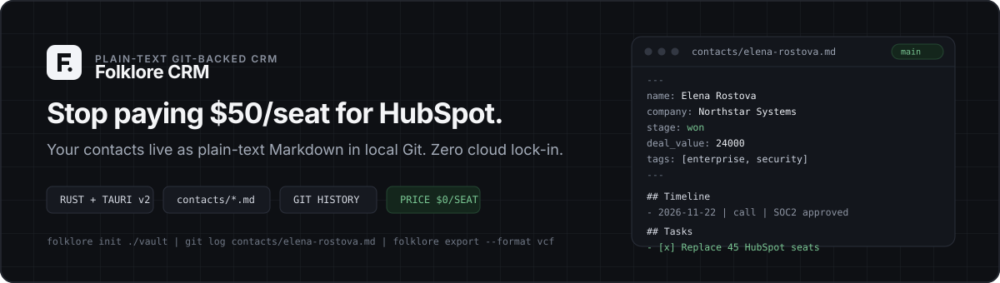

<p align="center">
  
</p>

<p align="center">
  
  
  
  
  
  
</p>

# Stop paying $50/seat for HubSpot. Manage your contacts in plain text with the Git-backed CRM.

Folklore CRM is a local-first, zero-cloud micro-CRM built in **Rust** (`folklore-core` + single CLI binary) and **Tauri v2 + React 19**. Every contact is a human-readable YAML frontmatter + Markdown file in `contacts/*.md`, versioned natively with local **Git**. Edit deals in the desktop Kanban board, log calls from your terminal, or update frontmatter directly in VS Code or Obsidian — Folklore syncs instantaneously via SHA-256 vault fingerprinting and preserves complete Git time-travel history.

---

## 15-Second Live Sync Demo

<p align="center">
  
</p>

> **Drop-in GIF slot:** Recording a custom walkthrough for a release or blog post? Drop your screen capture at `assets/demo.gif` and swap `assets/demo-git-sync.svg` above to `assets/demo.gif`.

---

## Why This Exists

Most small teams, indie founders, agencies, and technical revenue groups do not need a bloated 400-feature enterprise SaaS suite. Yet the default industry playbook still forces you into:

- **$50 to $150 per seat every month** in recurring SaaS rent just to store contact names, notes, and a 6-stage pipeline.
- **Proprietary database lock-in**, rate-limited APIs, and paid "export tiers" that hold your own customer history hostage.
- **Zero real audit history**: when a teammate overwrites a deal note or stage, you cannot run `git log` or restore a single file to last Tuesday.
- **Forced cloud migrations and UI churn** that slow down every interaction behind spinners and upsell banners.

Folklore CRM flips the model completely. Your CRM is a plain folder of Markdown files inside a standard local Git repository. It works 100% offline, opens in any text editor ever written, diffs cleanly in Pull Requests, and costs **$0/seat forever**.

---

## CRM SaaS Killed

| Capability | Folklore CRM | HubSpot Sales Hub | Attio | Pipedrive | Clay |
| :--- | :--- | :--- | :--- | :--- | :--- |
| **Seat Pricing** | **$0/seat forever** | $50 - $150/seat/mo | $36 - $86/seat/mo | $24 - $79/seat/mo | $20 - $40/seat/mo |
| **Data Format** | Plain-text `contacts/*.md` | Proprietary cloud DB | Proprietary cloud DB | Proprietary cloud DB | Proprietary cloud DB |
| **Version History & Rollback** | Native local Git (`log` / `restore`) | Paid Enterprise tiers | Limited activity log | Limited audit log | None |
| **External Editor Sync (VS Code / Obsidian)** | Instant SHA-256 live sync | No | No | No | No |
| **Offline / Air-Gapped Mode** | 100% offline native binary | No | No | No | No |
| **Single-Binary CLI Automation** | Yes (`folklore` Rust CLI) | API token + rate limits | API token + rate limits | API token + rate limits | Limited |
| **Vendor Lock-In** | Zero (plain `.md` + CSV + vCard) | High | Medium-High | Medium-High | Medium |

---

## 1-Click Install & Usage

### 1. Standalone Rust CLI Binary (1-Click Download)

Download the pre-built release binary from the [v1.0.0 GitHub Release](https://github.com/xity4uu-a11y/folklore-crm/releases/tag/v1.0.0) (`folklore-windows-amd64.exe` + `SHA256SUMS.txt`), or build directly from source:

```bash
cargo build --release -p folklore-core
# Binary produced at: target/release/folklore (or target/release/folklore.exe on Windows)
```

Initialize a Git-backed CRM vault in one command:

```bash
folklore init ./my-crm-vault
cd ./my-crm-vault

# Inspect your pipeline, list contacts, add a deal, log a call, commit to Git
folklore list
folklore add --name "Ada Lovelace" --email "ada@analytical.io" --company "Analytical Engines" --role "CTO" --stage proposal --value 28000 --tags "enterprise,git-native"
folklore log ada-lovelace --kind call --note "Reviewed self-hosted Git sync and zero seat cost."
folklore pipeline
folklore status
folklore commit -m "deal(ada-lovelace): add proposal and initial call log"
folklore history ada-lovelace

# Time-travel rollback to any previous Git commit
folklore restore ada-lovelace --rev HEAD~1

# 1-click portable exports (OWASP CSV formula-injection safe & RFC 6350 vCard 4.0)
folklore export --format csv --output contacts.csv
folklore export --format vcf --output contacts.vcf
```

### 2. Plain-Text `contacts/*.md` Format Spec

Every contact file is clean, Obsidian- and VS Code-compatible Markdown with deterministic YAML frontmatter:

```markdown
---
id: elena-rostova
name: Elena Rostova
email: elena@northstar.dev
company: Northstar Systems
role: VP of Engineering
stage: proposal
deal_value: 24000
currency: USD
next_followup: 2026-12-01
tags: [enterprise, security, founder-led]
owner: founder
website: https://northstar.dev
phone: +1-415-555-0142
---

## Context
Replacing 45 HubSpot Enterprise seats with a local-first plain-text vault.
Security team requires full Git commit provenance for every account edit.

## Timeline
- 2026-11-22 | call | Reviewed Git rollback workflow and VS Code live-sync latency.
- 2026-11-14 | email | Delivered SOC2 self-hosted architecture brief.

## Tasks
- [ ] Send annual enterprise support SLA redlines
- [x] Share deterministic SHA-256 vault sync specification
```

Supported pipeline stages and default weighted close probabilities:
- `lead` (15%)
- `qualified` (35%)
- `proposal` (60%)
- `negotiation` (80%)
- `won` (100%)
- `lost` (0%)

### 3. Desktop App (Tauri v2 + React 19 UI)

Run the minimalist Light/Dark desktop interface or browser vault preview:

```bash
# Run React 19 + TypeScript UI preview in browser (includes 6-contact local simulator)
cd ui
npm install
npm run dev

# Build production Tauri v2 desktop bundle (Windows MSI/EXE, macOS DMG, Linux AppImage/DEB)
npm run build
cd ../src-tauri
cargo tauri build
```

Desktop IPC commands (`src-tauri/src/lib.rs`) wrap `folklore-core` directly and spawn a background SHA-256 vault watcher that emits `vault-synced` events whenever you save a `contacts/*.md` file in VS Code, Obsidian, or Vim.

### 4. Optional Private Git Remote Sync

Folklore requires zero cloud accounts. If you want encrypted multi-device sync or team Pull Requests over your contacts, attach any private Git remote:

```bash
cd ./my-crm-vault
git remote add origin git@github.com:your-org/private-crm-vault.git
git push -u origin main
```

---

## Community Plugins & Pipeline Skills

Folklore ships with a strict JSON manifest schema (`plugins/schema.json`) validated by both Rust (`folklore validate-plugins`) and Node (`node scripts/validate-plugins.mjs`). Five community manifests are included out of the box:

| Plugin ID | Kind | Purpose |
| :--- | :--- | :--- |
| `b2b-saas-pipeline` | `pipeline` | Stage probabilities, weighted ARR forecasting, and 30-day cycle guardrails |
| `stale-relationship-radar` | `radar` | Flags open deals with zero touchpoints over 14 days |
| `meeting-notes-importer` | `importer` | Maps local Markdown meeting notes into `## Timeline` and `## Tasks` |
| `cold-outreach-snippets` | `snippets` | Parameterized plain-text follow-up templates referencing frontmatter keys |
| `vcard-csv-portable-export` | `exporter` | 1-click RFC 6350 vCard 4.0 and OWASP formula-safe CSV exports |

Validate all plugin manifests locally:

```bash
folklore validate-plugins --dir plugins
node scripts/validate-plugins.mjs
```

---

## Architecture & Security

- **100% Pure-Rust Core (`crates/folklore-core`)**: Zero C, OpenSSL, or WebView link dependencies. Compiles cleanly across Linux, macOS, and Windows GNU/MSVC targets.
- **Strict Path & Git Argument Hardening**:
  - `validate_contact_id` blocks `..`, `/`, `\`, null bytes, leading dashes, non-ASCII control characters, and cross-platform reserved device names (`CON`, `AUX`, `NUL`, etc.).
  - Every `git` invocation passes explicit argument arrays to `std::process::Command` (zero shell execution), separates pathspecs with `--`, and rejects option-like refs starting with `-`.
- **OWASP CSV Formula Neutralization**: Exported CSV text fields beginning with `=`, `+`, `-`, `@`, `\t`, or `\r` are safely neutralized before RFC 4180 quoting.
- **Reproducible Verification**:
  - `cargo test -p folklore-core -- --nocapture` (unit tests + real temporary local Git lifecycle tests)
  - `cargo clippy -p folklore-core --all-targets -- -D warnings`
  - `cd ui && npm run typecheck && npm test && npm run build`

---

## Contributing & License

Contributions and community plugin PRs are welcome — see [CONTRIBUTING.md](CONTRIBUTING.md) for the 25-line plugin template and verification checklist.

Released under the [MIT License](LICENSE).
